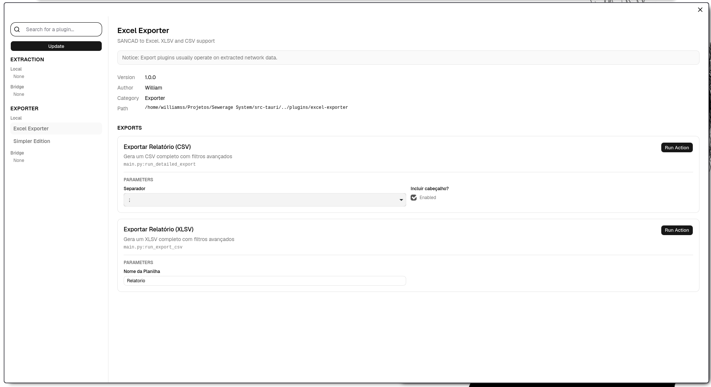

Overview
---
* **Cross-platform** Flux runs on Windows, macOS and Linux operating systems.
* **Platform-agnostic** Seamlessly import and export network data across major CAD and BIM ecosystems, including AutoCAD, ZwCAD and Revit.
* **Underlying technology**
  * **Tauri & React** Lightweight, secure desktop GUI powered by Webview2/WebKit.
  * **Python** Embedded Python Runtime for working with your data
  * **JSON-RPC Bridges** TCP socket communication layer with external CAD/BIM.

Installing
---
Precompiled packages for stable releases are available for Windows, macOS and Linux on the
[latest releases page](https://github.com/itsWilliam-San/Flux/releases/latest).

Plugins
---
While the native plugin manager is under development, third-party plugins can be installed manually by placing their folders directly into the application's data directory depending on your operating system:

- **Linux**: `~/.local/share/com.williamss.flux/plugins/`
- **Windows**: `%APPDATA%\com.williamss.flux\plugins\` *(e.g., `C:\Users\<YourUsername>\AppData\Roaming\com.williamss.flux\plugins\`)*

Each plugin must be placed inside its own dedicated subdirectory within the `plugins/` folder containing their respective Python scripts, files, and most importantly, a `manifest.json` file.

For *Bridge Plugins* you need to connect to `localhost` using port 8080.

See the [PLUGINS.MD](PLUGINS.md) for more information about developing and using plugins.

Roadmap
---
Flux is still in **Alpha** so many things are subject to change are to change or be implemented. Below is a list of all features to be added before a *Gold Release*.

- Load/Save System data (Check the `docs/contracts/network/network-v1.md` for more info).
- Add tag support for plugins.
- Plugin Version Compatibility Check: Update the plugin manifest to declare compatibility with the current Flux Version.
  Flux must validate this check before loading any plugin. Flux should also allow users to override compatibility blocks.
- Support optional localization for third-party plugins.
- Create a native plugin manager that can install third-party plugins from a specific source.
- Add support for macOS users (Intel/Arm).
